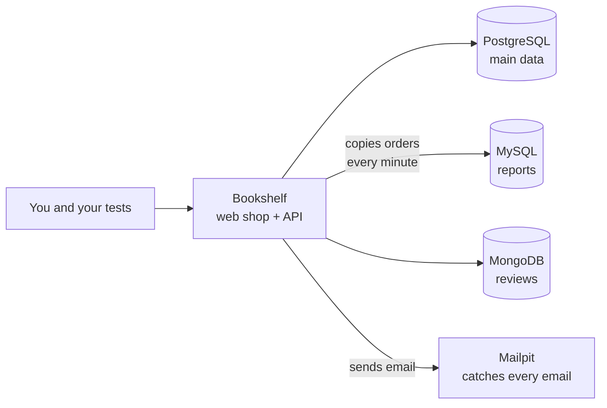
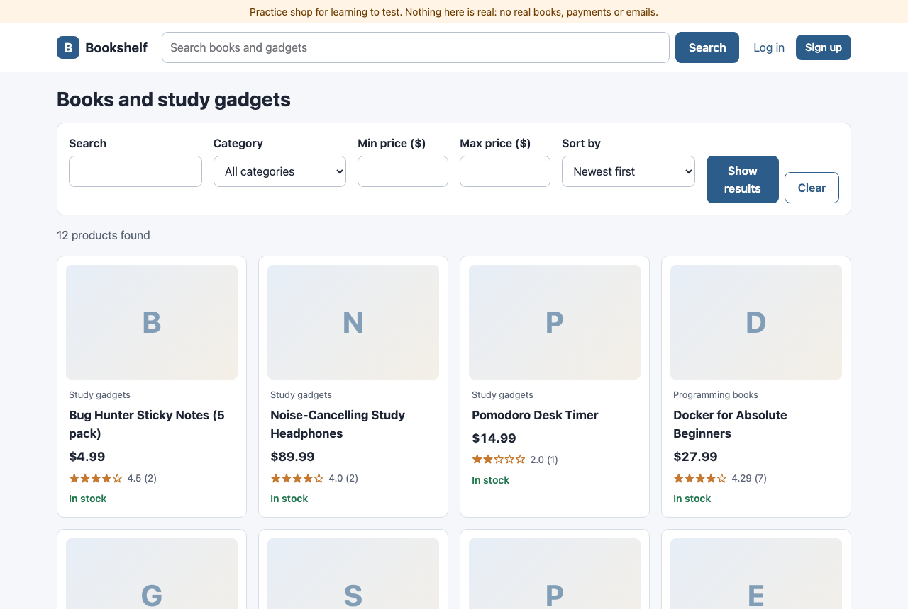
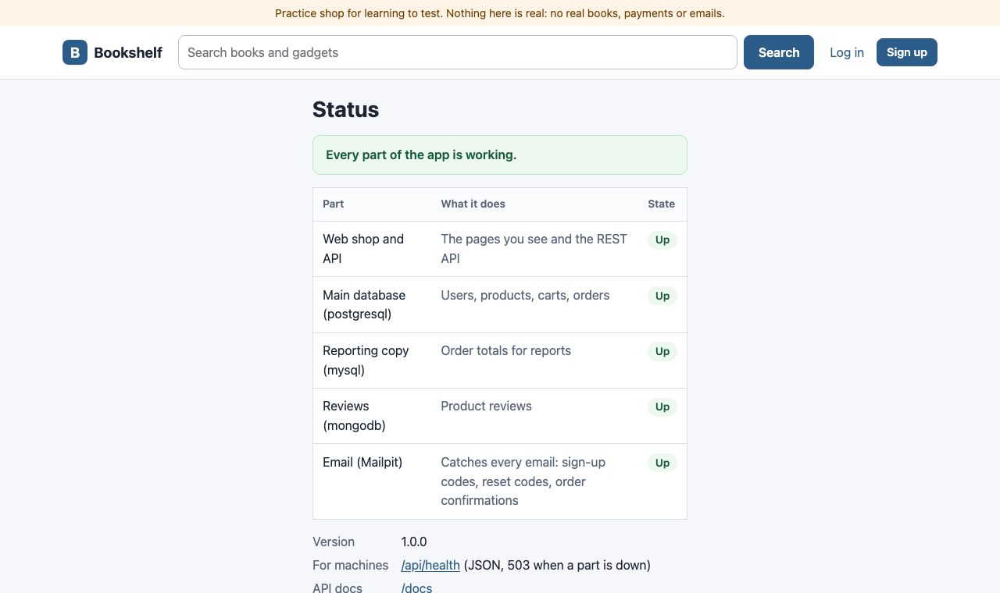
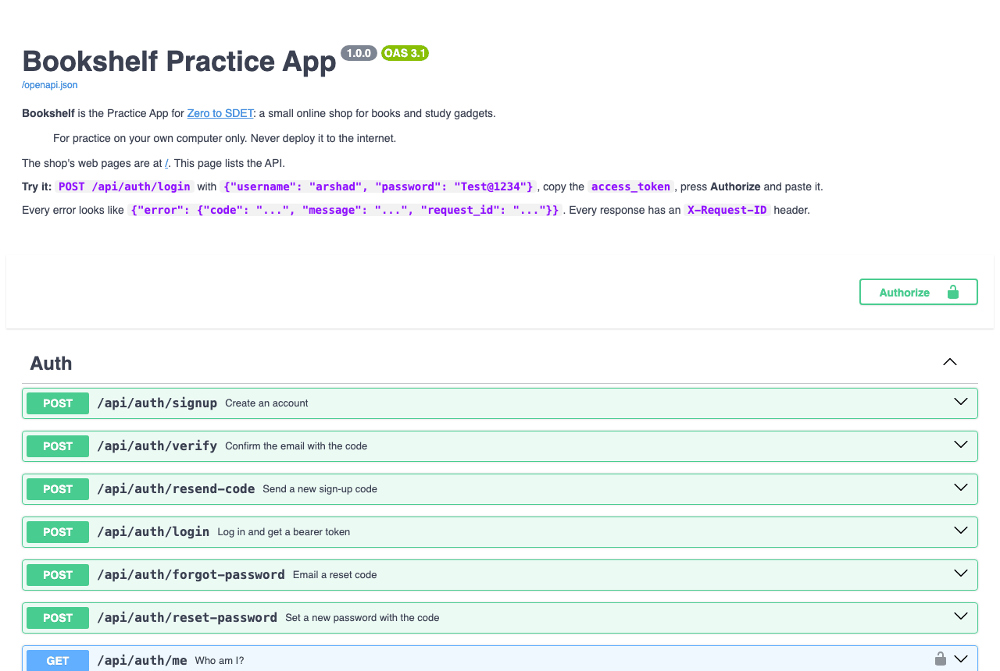
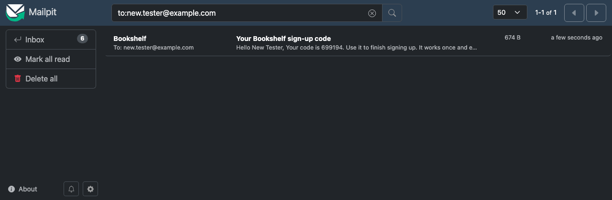

# Practice App Tour: the Shop You Test in Every Lesson

Bookshelf is a small online shop made for testing. Every lesson on this site tests it, so you always practise on the same app.

!!! note "Before you start"
    You don't need anything installed to read this page. Every step shows what you would see.
    To run the app yourself, you need [Docker Desktop](https://docs.docker.com/get-started/get-docker/), or a free GitHub account for Codespaces.
    New words are explained in the [Glossary](../../glossary.md).

## What you will learn

- What the Practice App does, and what is inside it
- How to start it with one command, and how to stop it
- How to reset its data when you want a clean start
- Where to find its API docs, its emails and its databases
- How Bug Hunts work (the answers are folded at the end)

## Why this matters at work

On a real team, you test an app that many parts work together to run: a web page, an API, a few databases and an email service. You also need test data you can reset, and test accounts you can trust. The Practice App gives you all of that in a safe place, so the skills move straight to your job.

## The idea in plain words

!!! info "In plain words"
    Think of a driving school car park. The cones, lines and traffic lights are real, but nobody gets hurt if you bump something.
    The Practice App is the same: a real shop with real parts, but every name, email, card and password is fake, and it runs only on your own computer.

The shop sells books and study gadgets. You can sign up, search, add to a cart, pay with a fake card, and see your orders. An admin can change stock and ship orders.

Here are its parts. Your tests talk to the API or the web page, and the app does the rest:



| Part | What it does | Lessons that use it |
| --- | --- | --- |
| Web shop | Pages you click through | UI automation |
| API | The same shop, for code | API testing |
| PostgreSQL | Users, products, carts, orders | Database testing |
| MySQL | A copy of orders for reports | Multi-database testing |
| MongoDB | Product reviews | Multi-database testing |
| Mailpit | Catches every email, so nothing reaches a real inbox | Sign-up and reset codes |

## Step by step

### 1. Start the app

=== "On your computer (Docker)"

    Open a terminal in the folder where you downloaded this project, and type:

    ```bash
    cd practice-app
    docker compose up -d
    ```

    The first start downloads and builds everything, so it takes a few minutes. Later starts take about half a minute. At the end you should see:

    ```text
     Container bookshelf-postgres-1 Healthy
     Container bookshelf-mysql-1 Healthy
     Container bookshelf-mongo-1 Healthy
     Container bookshelf-mailpit-1 Healthy
     Container bookshelf-app-1 Started
    ```

=== "In the cloud (Codespaces)"

    Open the project on GitHub and click **Open in GitHub Codespaces**, then **Create codespace**.
    Wait a few minutes. The app starts by itself.
    Open the **Ports** tab and click the globe icon next to port **8080**.

    Your Codespace is private: only you can open it. Never change a port to **Public**.

### 2. Open the shop

Go to <http://127.0.0.1:8080>. You should see the shop:

{ loading=lazy }

Log in with one of these fake accounts:

| Username | Password | Role |
| --- | --- | --- |
| `arshad` | `Test@1234` | customer |
| `maria` | `Test@1234` | customer |
| `admin` | `local_only_password` | admin |

To pay, use a sandbox card. No real money moves:

| Card number | What happens |
| --- | --- |
| `4242 4242 4242 4242` | Payment succeeds |
| `4000 0000 0000 0002` | Payment is declined |
| `4000 0000 0000 9995` | Payment times out |

Use any future expiry date, like `12/30`, and any 3 digits as the CVC, like `123`.

### 3. Check that every part is running

Go to <http://127.0.0.1:8080/status>. Every part should say **Up**:

{ loading=lazy }

Tests use the same check in JSON, at `/api/health`. You should see:

```json
{
    "status": "ok",
    "services": {
        "api": "up",
        "main_database": "up",
        "reporting_database": "up",
        "reviews_database": "up",
        "email": "up"
    }
}
```

When a part is down, the status is `degraded` and the answer code is 503, not 200.

### 4. Look at the API docs

Go to <http://127.0.0.1:8080/docs>. This page lists every API endpoint, and you can try each one in the browser:

{ loading=lazy }

For example, `POST /api/auth/login` with `{"username": "arshad", "password": "Test@1234"}` gives you a login token:

```json
{
    "access_token": "eyJhbGci... (a long text)",
    "token_type": "bearer",
    "expires_in": 1800
}
```

The token lasts 30 minutes (1800 seconds). Every error has the same shape, so tests can check it easily:

```json
{
    "error": {
        "code": "NOT_AUTHENTICATED",
        "message": "Log in first.",
        "request_id": "0ab14b5c..."
    }
}
```

### 5. Read the emails

When you sign up, the shop emails you a 6-digit code. Mailpit catches it. Go to <http://127.0.0.1:58025>:

{ loading=lazy }

Tests can read emails too, with Mailpit's own API: `http://127.0.0.1:58025/api/v1/messages`.

### 6. Reset the data

Tests change data. When you want a clean start, type:

```bash
docker compose exec app python -m bookshelf reset
```

You should see:

```text
Done: every database is back to the seed data, and uploaded pictures are deleted.
```

You can also log in as `admin` and click **Reset all data** on the admin page. The data is the same on every computer after a reset, so your tests always start from the same place.

### 7. Stop the app

```bash
docker compose down
```

Your data stays for next time. To delete it too, type `docker compose down -v`.

## Bug Hunts

The app has bugs planted on purpose, like a game of hide and seek. Each topic ends with a Bug Hunt: you find the bugs with the skills you just learned, and write a bug report for each one.

Here is the starter set, with a hint for each one. Try to find them before you open an answer.

| Code | Where to look | Hint |
| --- | --- | --- |
| BH-01 | Cart totals | Shipping is free from $50.00. What happens at exactly $50.00? |
| BH-02 | Product list in the API | Ask for 5 products per page. Count the pages yourself. |
| BH-03 | The reports database | Cancel an order. Does it still count as a sale? |
| BH-04 | Invoices | Can you get an invoice for an order that is not yours? |
| BH-05 | The cart badge | Add 3 of one book. Look at the header on every page. |
| BH-06 | Password reset | A reset code lasts 10 minutes. Does it really stop working? |

To see how the shop should behave, start it with the bugs switched off:

```bash
PRACTICE_APP_BUGS=off docker compose up -d
```

??? success "Answer: BH-01, free shipping at exactly $50.00"
    **Expected:** shipping is $0.00 when the order is exactly $50.00.
    **Actual:** shipping is $4.99. Free shipping only starts at $50.01.
    **How to find it:** every price ends in .99, so first make your own test data. As `admin`, add a product that costs $25.00, then buy 2.
    **Technique:** boundary values. Test just below, at, and just above a limit.

??? success "Answer: BH-02, the page count is one short"
    **Expected:** `GET /api/products?size=5` says `"pages": 3` for 12 products (5 + 5 + 2).
    **Actual:** it says `"pages": 2`. The last, half-full page is not counted, so a test that follows `pages` misses products.
    **Technique:** boundary values for pages. Pick a total that does not divide evenly.

??? success "Answer: BH-03, cancelled orders count as sales"
    **Expected:** the `daily_sales` table in MySQL counts only paid, shipped and delivered orders.
    **Actual:** cancelled orders are added to the money and the order count.
    **How to find it:** place an order, cancel it, run the report sync as `admin`, then compare MySQL with PostgreSQL.
    **Technique:** compare the same data in two databases.

??? success "Answer: BH-04, anyone's invoice"
    **Expected:** as `arshad`, `GET /api/orders/2/invoice.pdf` gives 404, because order 2 belongs to `maria`.
    **Actual:** it gives Maria's invoice, with her name, email and address.
    **Technique:** change the id in the address and check you only see your own data. This bug is called IDOR. It is critical: it leaks personal data.

??? success "Answer: BH-05, the cart badge counts lines, not items"
    **Expected:** with 3 copies of one book, the badge in the header says 3.
    **Actual:** it says 1 on every page except the cart page.
    **Technique:** compare the same number in two places: the page, and `item_count` in `GET /api/cart`.

??? success "Answer: BH-06, an old reset code still works"
    **Expected:** after 10 minutes, the reset code gives `CODE_EXPIRED`.
    **Actual:** the password still changes.
    **How to find it:** ask for a code, then as `admin` move the app's clock 11 minutes ahead with `POST /api/admin/clock`, then use the code. The sign-up code does expire, so compare the two.
    **Technique:** time-based testing with a clock you control.

!!! warning "Common mistakes"
    - **Opening the app before it is ready.** The first start takes a few minutes. Wait for the status page to say every part is Up.
    - **Running two copies at once.** The app started without Docker and the Docker app both use port 8080. Stop one first.
    - **Changing a test account's password, then forgetting it.** Reset the data and the fake passwords come back.

!!! failure "If you see this error"
    **`Bind for 127.0.0.1:8080 failed: port is already allocated`**
    Something else already uses port 8080. Often it is another copy of the app. Stop it, then run `docker compose up -d` again.

    **`Cannot connect to the Docker daemon`**
    Docker Desktop is not running. Open it, wait until it says it is running, then try again.

    **`Refusing to start on 0.0.0.0`**
    You asked the app to be reachable from other computers while it still uses the fake passwords. Use `HOST=127.0.0.1` instead. This guard is there on purpose.

## Try it yourself

Log in as `maria` on the web shop. Find her order and download its invoice. Then log in as `arshad` and try to open Maria's order page.

??? success "Solution"
    1. Log in as `maria` with `Test@1234`. Click **My orders**, then order 2.
    2. Click **Download invoice (PDF)**. A PDF opens with "Invoice for order #2".
    3. Log out, and log in as `arshad`. Go to `http://127.0.0.1:8080/orders/2`.
    4. You see a "not found" page. Arshad cannot see Maria's order page. Now try the invoice address from Bug Hunt BH-04 and compare.

## Quick check

1. Which part catches the emails the app sends?

    ??? question "Answer"
        Mailpit. Nothing reaches a real inbox. You read the emails at port 58025.

2. You changed lots of data and want a clean start. What do you type?

    ??? question "Answer"
        `docker compose exec app python -m bookshelf reset`, or click **Reset all data** on the admin page.

3. Which address tells a test that every part of the app is running?

    ??? question "Answer"
        `/api/health`. It answers 200 with `"status": "ok"` when every part is up, and 503 when a part is down.

## References

- [Practice App README](https://github.com/arshaduzzaman-sm/zero-to-sdet/blob/main/practice-app/README.md): how to start, reset and stop it
- [Practice App design](https://github.com/arshaduzzaman-sm/zero-to-sdet/blob/main/practice-app/DESIGN.md): features, data model and API list
- [Docker Desktop](https://docs.docker.com/get-started/get-docker/): official download page
- [GitHub Codespaces](https://docs.github.com/en/codespaces/overview): official docs
- [Mailpit](https://mailpit.axllent.org/docs/): official docs

Written for Bookshelf 1.0.0. Links checked: November 2026.
