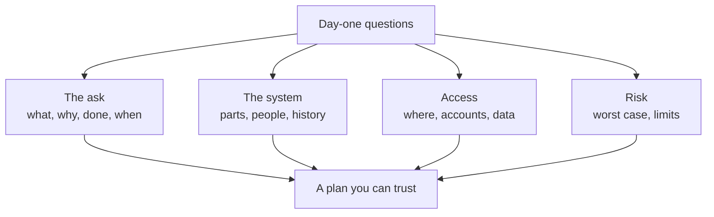

# Asking the Right Questions on Day One of a Testing Task

This lesson gives you the questions to ask before you test anything, and a checklist you can copy into your own work.

!!! note "Before you start"
    Read [The 9-step playbook](the-9-step-playbook.md) first. This lesson is step 1, "Understand the ask", in detail.
    **Scope** means what is part of the task, and what is not.

## What you will learn

- The four groups of day-one questions: the ask, the system, access, and risk
- How to write down answers so nobody forgets them
- How to ask without wasting your lead's time
- How the answers change your test plan

## Why this matters at work

A question that takes ten minutes on day one can save a week later. Testers who skip it often test the wrong thing, test in the wrong place, or don't know when they are finished. Good questions also show your lead that you think about risk, not just about clicking buttons.

## The idea in plain words

!!! info "In plain words"
    Before a taxi driver starts driving, they ask where you want to go. They don't drive around the city hoping to guess.
    Day-one questions are your "where to?" They make sure you drive to the right place.



## Step by step

1. **Copy the checklist** from the [template below](#the-template) into a new file or a ticket comment.

2. **Answer what you can yourself first.** Read the ticket, the docs and the code before you ask. Your lead's time is precious, and they will notice that you did your homework. For the password reset task, Arshad finds these himself:

    | Question | Answer | From |
    | --- | --- | --- |
    | Which parts does it touch? | API, database, email (Mailpit) | API docs at `/docs` |
    | Are there tests already? | Yes, in `practice-app/tests/test_auth.py` | The code |
    | How do I reset test data? | `python -m bookshelf reset` | Practice App README |

3. **Ask the rest in one message, not ten.** Group the questions so your lead can answer them in one go:

    ```text
    Hi! I'm starting on password reset testing. A few questions before I plan:
    1. Is the web page in scope, or only the API?
    2. What does "done" mean for you: a plan, tests, or both?
    3. Is the end of the sprint a fixed date?
    4. What worries you most about this feature?
    Thanks! I'll share a one-page plan by Thursday.
    ```

4. **Write the answers down, with who said them and when.** If an answer changes later, you can show why you planned the way you did.

    | Question | Answer | From | Date |
    | --- | --- | --- | --- |
    | Is the web page in scope? | Yes, the happy path only | Team lead | 2026-11-15 |
    | What does done mean? | Plan, API tests, bug reports | Team lead | 2026-11-15 |
    | What worries you most? | Old codes still working | Team lead | 2026-11-15 |

5. **Let the answers shape your plan.** The lead's worry, "old codes still working", becomes the first high risk in the plan. The web page "happy path only" goes into scope, and the rest of the web page goes out of scope.

    !!! success "Check: you should now have"
        A checklist with most answers filled in, one grouped message sent, and answers written down with names and dates.

## The template

=== "Day-one questions"

    ```markdown
    --8<-- "modules/think_like_a_tester/learning_a_new_testing_area/templates/day_one_questions.md"
    ```

=== "How to use it"

    1. Copy the file into your notes or the ticket.
    2. Tick each question when it has an answer.
    3. Put each answer in the table at the end, with who said it and the date.

## Common mistakes

!!! warning "Common mistakes"
    - **Asking what the docs already say.** Read first, then ask what is left.
    - **Asking one question at a time, all day.** Group them into one message.
    - **Keeping answers in your head.** Write them in the ticket, where the team can see them.
    - **Never asking about risk.** "What worries you most?" is often the most useful question of all.

!!! failure "If you see this error"
    **The lead answers: "Just test everything."**
    That is not an answer you can plan with. Ask a narrower question: "If I only had time for three tests, which three matter most?"

## Try it yourself

Your lead says: "Please test the invoice download in the shop." Using the checklist, write three questions you can answer yourself, and three you must ask.

??? success "Solution"
    You can answer yourself:

    - Which endpoint? `GET /api/orders/{id}/invoice.pdf` (from `/docs`).
    - Who can download? Only the order's owner (the docs say "my order").
    - Which orders have one? Paid ones; a pending order gives 409 (try it).

    You must ask:

    - Is the PDF layout in scope, or only that the right person gets the right file?
    - Does an invoice count as personal data in our company's rules?
    - What does done mean: tests, a bug report, or both?

## Quick check

1. What should you do before asking your lead anything?

    ??? question "Answer"
        Answer what you can yourself, from the ticket, the docs and the code.

2. Why write down who answered and when?

    ??? question "Answer"
        If an answer changes later, you can show why you planned the way you did.

3. Which question often turns into your first high risk?

    ??? question "Answer"
        "What worries you most about this feature?"

## References

- [ISTQB Glossary](https://glossary.istqb.org/): test basis, test scope and risk
- [Practice App README](https://github.com/arshaduzzaman-sm/zero-to-sdet/blob/main/practice-app/README.md)

Written for Bookshelf 1.0.0. Links checked: November 2026.
