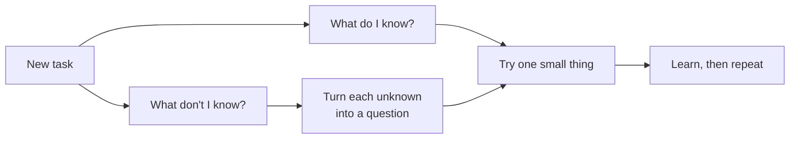

# How to Approach a Testing Task You Have Never Done

This lesson shows you how to spend the first hour of a task you have never done, so you start moving instead of feeling stuck.

!!! note "Before you start"
    You don't need any testing experience. It helps to have read the [Practice App tour](../../start-here/practice-app-tour/index.md), because the example uses it.
    A **testing task** is any job like "test this feature" or "set up tests for this service".

## What you will learn

- Why a new task feels hard, and why that is normal
- How to split a task into what you know and what you don't know
- How to turn "I don't know" into three small questions
- How to try one small thing in the first hour

## Why this matters at work

Testers change areas all the time: a new feature, a new tool, a new team. A lead will often hand you something nobody on the team has tested before. The people who do well are not the ones who already know everything. They are the ones who know how to start.

## The idea in plain words

!!! info "In plain words"
    Think of a big jigsaw puzzle. You don't try to see the whole picture at once. You find the corners and edges first, then fill in the middle.
    A new task is the same. You find the parts you already know first, and the empty parts become your questions.



## Step by step

We use Arshad's example task: "Test password reset in the shop."

1. **Write the task in one sentence, in your own words.** If you can't, you don't understand it yet.

    ```text
    Make sure users can safely get back into their account when they forget their password.
    ```

2. **Make two lists: what you know, and what you don't.** Spend five minutes. Don't look anything up yet.

    | I know | I don't know |
    | --- | --- |
    | The shop has user accounts | How the reset works step by step |
    | Users log in with a password | How the code reaches the user |
    | The shop has an API | What makes a reset "safe" |
    | I can run the Practice App | What "done" means for my lead |

3. **Turn each unknown into a question, and say who can answer it.**

    | Question | Who or what can answer |
    | --- | --- |
    | How does the reset work step by step? | The API docs at `/docs` |
    | How does the code reach the user? | Try it once, then look in Mailpit |
    | What makes a reset safe? | The [OWASP Forgot Password Cheat Sheet](https://cheatsheetseries.owasp.org/cheatsheets/Forgot_Password_Cheat_Sheet.html) |
    | What does "done" mean? | My lead |

4. **Try one small thing.** Pick the easiest unknown you can answer yourself. Arshad asks the shop for a reset code:

    ```bash
    curl -X POST http://127.0.0.1:8080/api/auth/forgot-password \
      -H "Content-Type: application/json" \
      -d '{"email": "arshad@example.com"}'
    ```

    You should see:

    ```json
    {"message": "If that email has an account, we sent a code to it."}
    ```

5. **Write down what you learned.** One unknown is now known: the code is sent by email, and the API does not say if the email has an account. Move that line to the "I know" list.

    !!! success "Check: you should now have"
        One sentence that says what the task is, two lists, a few questions with owners, and one thing you have already tried.

## Common mistakes

!!! warning "Common mistakes"
    - **Reading for days before trying anything.** Try one small thing in the first hour. It shows you what to read.
    - **Pretending to understand.** Writing "I don't know" on a list is not a weakness. It is the start of your plan.
    - **Asking "how do I test this?"** It is too big to answer. Ask small questions instead, like "where do I see the email?"

!!! failure "If you see this error"
    **`curl: (7) Failed to connect to 127.0.0.1 port 8080`**
    The Practice App is not running. Start it with `docker compose up -d` in the `practice-app` folder, then check <http://127.0.0.1:8080/status>.

## Try it yourself

Your lead says: "Can you test product reviews in the shop?" Make the two lists and three questions for this task. Then try one small thing.

??? success "Solution"
    One possible answer:

    | I know | I don't know |
    | --- | --- |
    | Products have star ratings | Who can write a review |
    | The shop has an API | Can one person review a product twice? |
    | | Where are reviews stored? |

    Questions: "Who can review?" (API docs), "Can I review twice?" (try it), "Where are reviews stored?" (the [Practice App tour](../../start-here/practice-app-tour/index.md) says MongoDB).

    A small first try: open <http://127.0.0.1:8080/api/products/6/reviews>. You should see a JSON list of reviews for one book.

## Quick check

1. What is the first thing to write down for a new task?

    ??? question "Answer"
        The task in one sentence, in your own words. If you can't write it, you don't understand it yet.

2. Why should you try one small thing in the first hour?

    ??? question "Answer"
        Trying something real shows you what you still need to learn, so your reading has a purpose.

3. "How do I test this?" is a weak question. Why?

    ??? question "Answer"
        It is too big for anyone to answer quickly. Small questions with a clear owner get fast answers.

## References

- [OWASP Forgot Password Cheat Sheet](https://cheatsheetseries.owasp.org/cheatsheets/Forgot_Password_Cheat_Sheet.html)
- [ISTQB Glossary](https://glossary.istqb.org/)

Written for Bookshelf 1.0.0. Links checked: November 2026.
