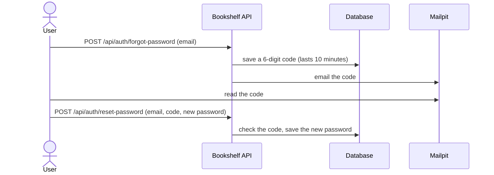

# Learning a New Testing Area: a 9-Step Playbook for Any Task

This topic shows you what to do when you get a testing task you have never done before. Every other topic on this site uses the same nine steps.

!!! info "In plain words"
    Imagine you move to a new city and need to find a doctor. You don't read every book about medicine first.
    You ask a neighbour where to go, look at a map, try the bus once, and ask again when you get lost.
    Learning a new testing area works the same way: ask, look, try something small, and learn as you go.

!!! example "Your task"
    Arshad is a tester on a shop team. His lead says: "Next sprint we test password reset. You have never tested login features, but can you own it?"
    This page follows Arshad through that task with the [Practice App](../../start-here/practice-app-tour/index.md). It is an example, but the steps are the ones real SDETs use.

## Jump to what you need

- [How to approach a task you have never done](how-to-approach-a-new-task.md): the first hour, without panic
- [The 9-step playbook](the-9-step-playbook.md): every step, and why it is in that order
- [Asking the right questions](asking-the-right-questions.md): day-one questions that save days of work
- [Reading official docs fast](reading-official-docs-fast.md): find the part you need in minutes
- [Learning from code and examples](learning-from-code-and-examples.md): read the code and tests that already exist
- [When to ask for help](when-to-ask-for-help.md): the 30-minute rule, and how to ask well

## 1. Understand the ask

Before you test anything, find out what "done" means. Arshad copies the [day-one questions checklist](#templates) and asks his lead five of them:

| Arshad asks | His lead answers |
| --- | --- |
| What exactly should I test? | Forgot password and reset password, in the API and the web page |
| Why now? | We are adding a "Forgot password?" link to the login page |
| What does "done" mean? | A plan I approve, tests for the main risks, and bug reports |
| When is it due? | End of next sprint |
| Where do I test? | The Practice App on your own computer |

Those five answers took ten minutes. Now Arshad knows what to test, what not to test, and when he is finished. [Asking the right questions](asking-the-right-questions.md) shows the full list.

## 2. Picture the system

Draw what you are testing and where the data goes. Arshad reads the API docs and draws this:



Now he can see the places where things could break: the code, the email, the time limit and the new password.

## 3. Learn just enough

Spend 30 to 60 minutes reading, not days. For this task, Arshad reads in this order:

1. The Practice App's API docs at `/docs`: the two reset endpoints and their fields (10 minutes).
2. The [OWASP Forgot Password Cheat Sheet](https://cheatsheetseries.owasp.org/cheatsheets/Forgot_Password_Cheat_Sheet.html): what a safe reset must do (20 minutes).
3. The app's existing tests for login, to see how the team tests (15 minutes).

He skips everything about passwords in general, encryption, and other login methods. They are not part of this task. [Reading official docs fast](reading-official-docs-fast.md) shows how to find the right part quickly.

## 4. Get something running

Try the feature once by hand within the first hour. It turns a vague task into something real. Arshad asks for a code:

```bash
curl -X POST http://127.0.0.1:8080/api/auth/forgot-password \
  -H "Content-Type: application/json" \
  -d '{"email": "arshad@example.com"}'
```

You should see:

```json
{"message": "If that email has an account, we sent a code to it."}
```

He opens Mailpit at <http://127.0.0.1:58025> and finds the email:

```text
Subject: Your Bookshelf password reset code
Hello Arshad, Your code is 894617. Use it to set a new password.
It works once and expires in 10 minutes.
```

Your code will be different: every code is new and random.

## 5. Decide what to test

List test ideas, then sort them by risk: what hurts users most if it breaks. Arshad uses the [test design techniques](../test-design-techniques/index.md) to find ideas:

| Risk | Test idea | Technique |
| --- | --- | --- |
| High | A code older than 10 minutes must not work | Boundary values |
| High | A code must work only once | Error guessing |
| High | Someone else's code must not reset my password | Negative test |
| Medium | Many wrong codes must stop working | Error guessing |
| Medium | The answer must not show if an email has an account | Compare two answers |
| Low | A short new password is refused | Negative test |

## 6. Write a one-page plan

Put the plan on one page and share it before you build tests. Your lead can catch a wrong idea in five minutes, before it costs you a week. Arshad fills in the [one-page test plan](#templates). You can read his [finished example plan](#templates) below.

## 7. Build in small steps

Build tests in this order, and run them after each step:

1. **Smoke test:** can I ask for a code at all? (the answer is 202)
2. **Happy path:** the normal way works: ask, read the code, reset, log in with the new password.
3. **Negative cases:** a wrong code, a used code, an old code, a weak password.
4. **Edge cases:** exactly 10 minutes, the fifth wrong try, two codes in a row.

A wrong code gives a clear error. You should see:

```json
{"error": {"code": "INVALID_CODE", "message": "That code is not right. Check the email again.", "request_id": "fba83a45..."}}
```

You will write these as automated tests in [API testing](../../core-automation/api-testing/index.md). For now, trying them by hand is enough.

## 8. Report and get feedback

Share three things with your lead: what you tested, what you found, and what is left. Keep it short. A bug you found gets a [bug report](../bug-reports/index.md). A risk you could not test goes into "Open questions" in your plan, so nobody forgets it.

## 9. Keep learning on your own

Keep a [learning log](#templates): five minutes a day, one entry. After a week it shows you, and your lead, how much you learned. Next, read [Test design techniques](../test-design-techniques/index.md) to find better test ideas, and [Bug reports](../bug-reports/index.md) to report what you find.

!!! tip "How an experienced SDET thinks about this"
    - "I don't know this yet" is a normal state of the job. Experienced people get there faster because they follow the same steps every time.
    - Ask questions early, when they are cheap. A question on day one costs ten minutes. The same question in week three can cost a rewrite.
    - Try the feature by hand before you automate it. You can't automate what you don't understand.
    - Write down what you decided not to test, and why. It protects you and your team later.

!!! warning "Red flags"
    - You have read for two days and still have not tried the feature once.
    - You can't say in one sentence what "done" means.
    - Your plan is longer than one page, or nobody has seen it.
    - You have been stuck on the same problem for more than an hour without asking anyone.
    - You are testing everything with the same care, instead of the risky parts first.

## Templates

Copy these into your own project. Each one starts with a comment line that says where it came from.

=== "Day-one questions"

    ```markdown
    --8<-- "modules/think_like_a_tester/learning_a_new_testing_area/templates/day_one_questions.md"
    ```

=== "One-page test plan"

    ```markdown
    --8<-- "modules/think_like_a_tester/learning_a_new_testing_area/templates/one_page_test_plan.md"
    ```

=== "Learning log"

    ```markdown
    --8<-- "modules/think_like_a_tester/learning_a_new_testing_area/templates/learning_log.md"
    ```

=== "Example: Arshad's plan"

    ```markdown
    --8<-- "modules/think_like_a_tester/learning_a_new_testing_area/examples/password_reset_test_plan.md"
    ```

## Bug Hunt

Use the playbook on the password reset of the Practice App. Follow steps 1 to 7 above. The risk list in step 5 already points at one planted bug.

Hint: try the "High" risks first. One of them does not behave the way the email says.

When you have found it, check your answer in the [Practice App tour](../../start-here/practice-app-tour/index.md#bug-hunts), Bug Hunt **BH-06** (folded, so you can't see it by accident).

## Official resources

- [OWASP Forgot Password Cheat Sheet](https://cheatsheetseries.owasp.org/cheatsheets/Forgot_Password_Cheat_Sheet.html): what a safe password reset must do
- [ISTQB Glossary](https://glossary.istqb.org/): the official meaning of testing words
- [Mailpit documentation](https://mailpit.axllent.org/docs/): read test emails by hand or with its API
