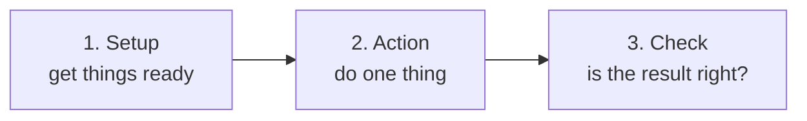

# Learning from Code and Examples: Read the Tests That Already Exist

This lesson shows you how to learn from the code and tests your team already has, even if you are new to reading code.

!!! note "Before you start"
    Read [Reading official docs fast](reading-official-docs-fast.md) first. You don't need to write Python yet; you only read it here.
    A **test file** is a file of small programs that each check one thing the app should do.

## What you will learn

- Where to find the tests that already exist
- How to read one test like a short story: setup, action, check
- How to make a list of what is already tested
- How to spot what is **not** tested yet

## Why this matters at work

Existing tests are the most honest documentation a team has. Docs say what should happen; tests prove what does happen, every time they run. They also show you how the team likes to write tests, so your work fits in. And the gaps between tests are often where bugs live.

## The idea in plain words

!!! info "In plain words"
    When you join a new football team, you watch a few practice games before you play. You learn the moves they already use.
    Reading the existing tests is watching practice. You learn the team's moves, and you notice the moves nobody practises.

Most tests follow the same three parts. Once you see them, any test is easier to read:



## Step by step

1. **Find the tests.** They usually sit in a folder called `tests`, with file names that start with `test_`. In this project, the Practice App's login tests are in `practice-app/tests/test_auth.py`.

2. **Read the test names first.** Good names read like sentences. In `test_auth.py` you find:

    ```text
    test_a_code_expires_after_10_minutes
    test_a_new_code_replaces_the_old_one
    test_forgot_password_gives_the_same_answer_for_unknown_emails
    test_reset_password_with_the_code
    ```

    Already you know four things the team cares about, without reading any code.

3. **Read one test like a story.** Here is the real reset test from the Practice App:

    ```python
    def test_reset_password_with_the_code(client, outbox):
        client.post("/api/auth/forgot-password", json={"email": "arshad@example.com"})
        code = code_in(outbox.last_to("arshad@example.com"))
        body = {"email": "arshad@example.com", "code": code, "new_password": "NewPass99"}
        assert client.post("/api/auth/reset-password", json=body).status_code == 200
        assert error_code(client.post("/api/auth/reset-password", json=body)) == "INVALID_CODE"
    ```

    In plain words:

    - **Setup:** ask for a reset code for Arshad, and read it from the email.
    - **Action:** send the code with a new password.
    - **Check:** the first try works (200). The second try with the same code fails (`INVALID_CODE`), so a code works only once.

    `assert` means "this must be true, or the test fails".

4. **Make a "tested" list.** Write one line per test, in plain words:

    | What is tested | Test |
    | --- | --- |
    | A sign-up code stops working after 10 minutes | `test_a_code_expires_after_10_minutes` |
    | A reset code works once | `test_reset_password_with_the_code` |
    | Known and unknown emails get the same answer | `test_forgot_password_gives_the_same_answer_for_unknown_emails` |

5. **Look for the gaps.** Put your risk list next to the "tested" list. Arshad's first high risk was "a reset code older than 10 minutes must not work". In `test_auth.py` there is a test for the **sign-up** code expiring, but none for the **reset** code. That gap is the first thing he tests by hand.

6. **Search the whole folder before you call it a gap.** Tests are not always where you expect. Search every test file for a word from your risk, like `invoice` or `expire`. In VS Code, use **Search in files** (Ctrl+Shift+F, or Cmd+Shift+F on a Mac).

    !!! success "Check: you should now have"
        A list of what is tested, in plain words, and at least one risk that no test covers yet.

## Common mistakes

!!! warning "Common mistakes"
    - **Trying to understand every line.** Read names first, then one test as setup, action, check. That is enough to start.
    - **Thinking "there are tests, so it works".** Tests only prove what they check. A gap is a place nobody is looking.
    - **Copying a test without knowing what it checks.** Say what it checks in one sentence before you reuse it.

!!! failure "If you see this error"
    **`zsh: command not found: pytest`** (or `'pytest' is not recognized` on Windows)
    pytest is installed inside the project's virtual environment, not for the whole computer. Run it from the repository folder with its full path: `.venv/bin/pytest practice-app/tests` (on Windows: `.venv\Scripts\pytest practice-app\tests`).

## Try it yourself

Open `practice-app/tests/test_cart_and_orders.py` (or read the names below). Which risk is tested, and which one is not?

```text
test_my_orders_newest_first_and_only_mine
test_cancel_a_paid_order
test_a_delivered_order_cannot_be_cancelled
```

??? success "Solution"
    Tested: you only see your own orders; a paid order can be cancelled; a delivered order cannot.

    Not in this list: can you get **someone else's invoice**? It looks like a gap. But search the folder for `invoice` first: `test_files_and_email.py` has `test_no_invoice_for_someone_elses_order`. A gap in one file is not always a gap. Search before you decide.

## Quick check

1. What are the three parts of most tests?

    ??? question "Answer"
        Setup, action, check.

2. Why read test names before the code?

    ??? question "Answer"
        Good names say what is tested in plain words. You learn a lot without reading any code.

3. Your risk has no test. What does that tell you?

    ??? question "Answer"
        It is a gap: nobody checks it, so a bug there would not be caught. Test it first.

## References

- [pytest: Anatomy of a test](https://docs.pytest.org/en/stable/explanation/anatomy.html): arrange, act, assert
- [pytest: Get started](https://docs.pytest.org/en/stable/getting-started.html)

Written for Bookshelf 1.0.0 and pytest 9. Links checked: November 2026.
