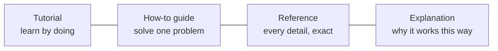

# Reading Official Docs Fast: Find the Part You Need in Minutes

This lesson shows you how to get what you need from official documentation quickly, without reading all of it.

!!! note "Before you start"
    Read [Asking the right questions](asking-the-right-questions.md) first: your questions tell you what to look for.
    **Official docs** are the pages written by the people who made the tool or the app. They are the most trustworthy source.

## What you will learn

- Why official docs come before blog posts and videos
- The four kinds of pages most docs have, and which one to open first
- How to read an API page: the fields, the rules and the answers
- How to check you are reading the right version

## Why this matters at work

Every new area comes with new docs: a tool, a library, an API. Reading all of it takes days. Reading none of it means guessing. The skill is to find the one page that answers your question, read it carefully, and stop.

## The idea in plain words

!!! info "In plain words"
    A cookbook has hundreds of recipes, but you only cook one tonight. You use the index, go to that page, and read it carefully.
    Docs are the same. You don't read the whole book. You find tonight's recipe.

Most documentation has four kinds of pages. Knowing which kind you need saves a lot of time:



| You want to... | Open this kind of page |
| --- | --- |
| Try something for the first time | Tutorial or "Getting started" |
| Do one specific thing | How-to guide |
| Know an exact field, option or error | Reference (like the API docs) |
| Understand a design decision | Explanation |

## Step by step

Arshad needs to know exactly what the reset endpoint expects. That is a reference question.

1. **Start at the official source.** For the Practice App that is the API docs at <http://127.0.0.1:8080/docs>. For a tool, it is the tool's own website, not a blog post about it.

2. **Find the one page you need.** Use the page's search or the browser's find (Ctrl+F, or Cmd+F on a Mac). Arshad searches for "reset" and finds `POST /api/auth/reset-password`.

3. **Read the example first, then the rules.** Examples show the normal case fast. The rules show the limits. The same rules are in the app's machine-readable description at `/openapi.json`:

    ```json
    {
      "properties": {
        "email": {"type": "string", "examples": ["arshad@example.com"]},
        "code": {"type": "string", "pattern": "^\\d{6}$", "examples": ["123456"]},
        "new_password": {"type": "string", "minLength": 8, "maxLength": 128}
      },
      "required": ["email", "code", "new_password"]
    }
    ```

4. **Turn each rule into a test idea.** Rules are where bugs hide, because every rule has a limit:

    | Rule in the docs | Test ideas |
    | --- | --- |
    | `code` is exactly 6 digits (`^\d{6}$`) | 5 digits, 7 digits, letters |
    | `new_password` is 8 to 128 characters | 7, 8, 128 and 129 characters |
    | All three fields are required | Leave each one out |

5. **Check one rule for real.** Send a 5-character password:

    ```bash
    curl -X POST http://127.0.0.1:8080/api/auth/reset-password \
      -H "Content-Type: application/json" \
      -d '{"email": "arshad@example.com", "code": "000000", "new_password": "short"}'
    ```

    You should see the rule from the docs, enforced:

    ```json
    {"error": {"code": "VALIDATION_ERROR", "message": "Some fields are missing or not valid.",
      "request_id": "743c78f2...",
      "details": [{"field": "new_password", "message": "String should have at least 8 characters"}]}}
    ```

6. **Check the version.** Docs change between versions. The Practice App shows its version at the top of `/docs` (1.0.0) and at `/api/version`. For tools, check the version picker on the docs site matches what you installed.

    !!! success "Check: you should now have"
        One reference page found, its rules listed, a test idea for each rule, and one rule checked for real.

## Common mistakes

!!! warning "Common mistakes"
    - **Starting with a random blog post.** It may be old, wrong, or about another version. Start with the official docs.
    - **Reading a tutorial when you need a reference.** Tutorials skip the limits, and limits are what testers need.
    - **Trusting the docs blindly.** Docs can be wrong. When the app and the docs disagree, that is a finding: report it.

!!! failure "If you see this error"
    **`{"error": {"code": "NOT_FOUND", "message": "Not Found", ...}}` when you try an endpoint from a blog post**
    The post is about another version, or another app. Go back to the official docs for your version.

## Try it yourself

Open <http://127.0.0.1:8080/docs> and find `POST /api/cart/items`. Write three test ideas from its rules.

??? success "Solution"
    The docs say `quantity` must be between 1 and 10, and `product_id` must exist. Test ideas:

    1. Quantity 0 and 11 (just outside the limits) should give `VALIDATION_ERROR`.
    2. Quantity 1 and 10 (on the limits) should work.
    3. A product id that does not exist, like 9999, should give `PRODUCT_NOT_FOUND`.

## Quick check

1. You need to know the exact maximum length of a field. Which kind of page do you open?

    ??? question "Answer"
        A reference page, like the API docs.

2. Why read the rules, not only the example?

    ??? question "Answer"
        Every rule has a limit, and limits are where bugs hide. The example only shows the normal case.

3. The app does something the docs say it should not do. What is that?

    ??? question "Answer"
        A finding. Either the app or the docs is wrong. Report it.

## References

- [Diátaxis](https://diataxis.fr/): the four kinds of documentation pages
- [OpenAPI Specification](https://spec.openapis.org/oas/latest.html): the format behind `/openapi.json`
- [ISTQB Glossary](https://glossary.istqb.org/)

Written for Bookshelf 1.0.0. Links checked: November 2026.
