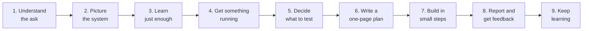

# The 9-Step Playbook for Testing Something New

This lesson explains the nine steps you can use for any testing task, and why they come in this order.

!!! note "Before you start"
    Read [How to approach a task you have never done](how-to-approach-a-new-task.md) first. It covers the first hour.
    A **playbook** is a list of steps a team follows every time, so nobody has to invent the plan again.

## What you will learn

- The nine steps, in order
- What you should have at the end of each step
- Why the order matters
- How much time each step usually takes

## Why this matters at work

When a task is new, it is easy to jump straight into writing tests, or to read for days without starting. Both waste time. A fixed list of steps keeps you moving, and it makes your work easy for your lead to follow. Every topic on this site uses these nine steps, so you will see them again and again.

## The idea in plain words

!!! info "In plain words"
    Think of cooking a new recipe. You read what the dish is, check what is in the fridge, read the recipe once, and taste as you go.
    You don't cook the whole meal and only taste it at the end. Testing works the same way: small steps, checked as you go.



## Step by step

Each step ends with something you can show. If you can't show it, the step is not finished.

| Step | What you do | What you have at the end | Usual time |
| --- | --- | --- | --- |
| 1. Understand the ask | Ask your lead what, why, "done", deadline, where | Written answers | 15 to 30 minutes |
| 2. Picture the system | Draw the parts and where the data goes | A simple diagram | 30 minutes |
| 3. Learn just enough | Read the official docs for this task only | Notes and links | 30 to 60 minutes |
| 4. Get something running | Try the feature once, by hand | One real result | Under 1 hour |
| 5. Decide what to test | List test ideas, sort them by risk | A risk list | 1 hour |
| 6. Write a one-page plan | Fill in the plan template, share it | A plan your lead has seen | 1 hour |
| 7. Build in small steps | Smoke test, happy path, negative cases, edge cases | Running tests | Most of the task |
| 8. Report and get feedback | Share results, bugs and open risks | A short summary | 30 minutes |
| 9. Keep learning | Write a learning log entry, pick what to read next | A log | 5 minutes a day |

The times are a starting guide, not a rule. A big task takes longer; a small one may finish steps 1 to 6 in one morning.

### Why this order?

- **Ask before you read.** The answers tell you what to read, so you read less.
- **Draw before you test.** The diagram shows where things can break.
- **Try before you plan.** One real result makes your plan realistic.
- **Plan before you build.** Your lead can fix a wrong idea in five minutes. A wrong test suite takes days to fix.
- **Small steps before big ones.** If the smoke test fails, there is no point running 50 other tests.

### Step 7 in more detail

These four words come up in every topic:

- **Smoke test:** the quickest check that the feature works at all. Example: asking for a reset code gives 202.
- **Happy path:** the normal way a user uses the feature, with good data. Example: ask for a code, use it, log in with the new password.
- **Negative test:** a test with bad input that should be refused. Example: a wrong code gives `INVALID_CODE`.
- **Edge case:** a test at the limit. Example: a code used at exactly 10 minutes.

!!! success "Check: you should now be able to"
    Name the nine steps in order, and say what you have at the end of each one.

## Common mistakes

!!! warning "Common mistakes"
    - **Skipping step 6 because the task is small.** Even a five-line plan, shared in a chat message, counts.
    - **Doing step 7 all at once.** Run each test as soon as you write it. Ten tests written blind fail in ten confusing ways.
    - **Treating step 9 as optional.** A five-minute log entry is how a new area becomes your strength.

!!! failure "If you see this error"
    **`{"error": {"code": "VALIDATION_ERROR", ... "field": "new_password", "message": "String should have at least 8 characters"}}`**
    This is the shop refusing a weak password: it is a negative test that passed, not a problem with your setup. Write it down as a result.

## Try it yourself

Pick one step from the table. For the task "test product reviews in the Practice App", write what you would have at the end of that step.

??? success "Solution"
    Example for step 2, "Picture the system":

    ```mermaid
    flowchart LR
        U["User"] --> A["Bookshelf API"]
        A --> M[("MongoDB<br/>reviews")]
        A --> P[("PostgreSQL<br/>orders")]
    ```

    The diagram shows a question worth asking: does the shop check in the orders database that you bought the product before you can review it? (It does: only buyers can review.)

## Quick check

1. Why do you try the feature by hand (step 4) before writing the plan (step 6)?

    ??? question "Answer"
        One real result makes the plan realistic. You find out how the feature really works before you decide what to test.

2. What is the difference between a happy path and a negative test?

    ??? question "Answer"
        A happy path uses the feature the normal way with good data. A negative test uses bad input that the app should refuse.

3. Which step protects you from building the wrong tests for a week?

    ??? question "Answer"
        Step 6: sharing a one-page plan before you build. Your lead can correct a wrong idea in minutes.

## References

- [ISTQB Glossary](https://glossary.istqb.org/): smoke test, negative testing and other terms
- [OWASP Forgot Password Cheat Sheet](https://cheatsheetseries.owasp.org/cheatsheets/Forgot_Password_Cheat_Sheet.html)

Written for Bookshelf 1.0.0. Links checked: November 2026.
