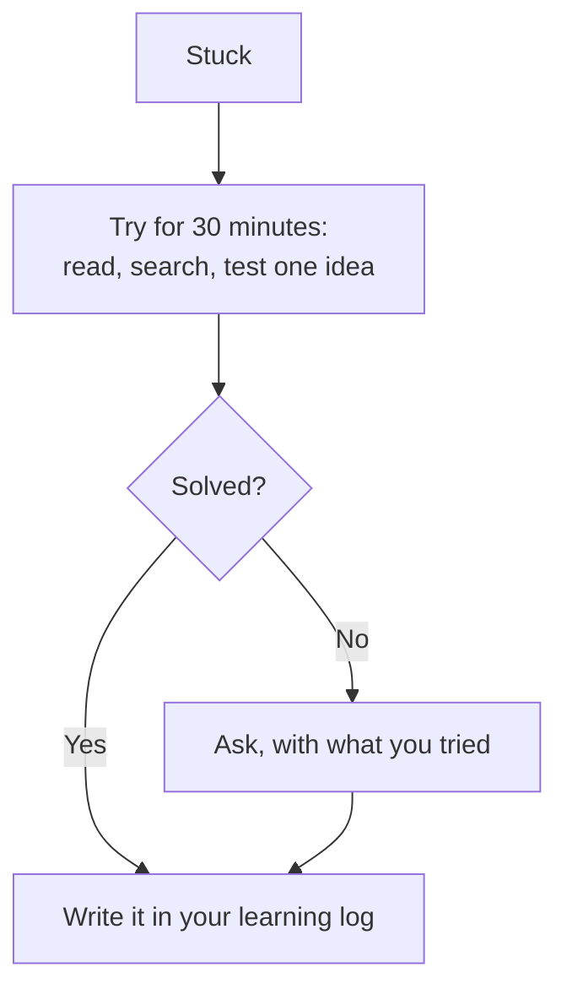

# When to Ask for Help: the 30-Minute Rule and How to Ask Well

This lesson shows you when to stop trying alone, how to ask so people can answer fast, and how to keep a learning log.

!!! note "Before you start"
    Read [Learning from code and examples](learning-from-code-and-examples.md) first.
    Being stuck is a normal part of learning. This page is about being stuck for less time.

## What you will learn

- The 30-minute rule: try first, then ask
- What to write in a help message
- Where to ask: a person, the team chat, or the tool's community
- How a learning log helps you, and shows your progress

## Why this matters at work

New people often wait too long to ask, because they don't want to look slow. Others ask too early, before they have tried anything. Both cost time. A clear rule and a good message make asking easy for you and quick for the person who helps.

## The idea in plain words

!!! info "In plain words"
    When you are lost in a shopping centre, you first look at the map. If you are still lost after a few minutes, you ask someone, and you say where you are and where you want to go.
    You don't wander for two hours. And you don't ask before looking at the map at all.



## Step by step

1. **Try on your own for about 30 minutes.** Read the error message slowly. Search the official docs for it. Try one idea at a time. Thirty minutes is a guide: ask sooner if something is blocking the whole team, or if you might break shared data.

2. **Write down what you tried as you go.** You will need it for your message, and it often shows you the answer.

3. **If you are still stuck, write a help message with four parts:**

    | Part | Example |
    | --- | --- |
    | What I am trying to do | Start the Practice App for the reset tests |
    | What I expected | The status page says every part is Up |
    | What happened (exact error) | `Bind for 127.0.0.1:8080 failed: port is already allocated` |
    | What I tried | Restarted Docker; checked the docs; the error stays |

    Put together, it looks like this:

    ```text
    Hi! I'm trying to start the Practice App for the password reset tests.
    I expected the status page to say every part is Up, but docker compose says:
      Bind for 127.0.0.1:8080 failed: port is already allocated
    I restarted Docker Desktop and read the README's "Start it" section. Same error.
    Could something else be using port 8080? Thanks!
    ```

4. **Ask in the right place.** A question about your team's app goes to your team. A question about a tool, like pytest, can go to the tool's official forum or issue tracker. Search there first: someone may have asked already.

5. **Close the loop.** When it is solved, reply with what fixed it ("another copy of the app was running; I stopped it"). The next person with the same problem will find your answer.

6. **Write it in your learning log.** One entry, five minutes:

    ```markdown
    ## 2026-11-15

    - **Goal today:** start the Practice App and try the reset flow
    - **What I read or watched:** Practice App README, "Start it with one command"
    - **What I tried:** docker compose up -d; got "port is already allocated"
    - **What I learned:** two programs can't use the same port; stop one first
    - **Still confused about:** how to see which program uses a port
    - **Next step:** ask for a reset code and read it in Mailpit
    ```

    !!! success "Check: you should now be able to"
        Say when you would ask for help, write a four-part help message, and keep one learning log entry.

## The template

=== "Learning log"

    ```markdown
    --8<-- "modules/think_like_a_tester/learning_a_new_testing_area/templates/learning_log.md"
    ```

=== "How to use it"

    1. Copy the file once for each new area you learn.
    2. Add one entry at the end of each day, newest at the bottom.
    3. Share it with your lead at your one-to-one meetings: it shows your progress without extra work.

## Common mistakes

!!! warning "Common mistakes"
    - **"It doesn't work."** Always paste the exact error text. "It doesn't work" can't be answered.
    - **A screenshot of text.** Paste errors as text, so people can copy and search them.
    - **Sharing secrets in a help message.** Never paste passwords, tokens or customer data. Replace them with `***`.
    - **Never closing the loop.** Say what fixed it, so the next person can find the answer.

!!! failure "If you see this error"
    **`Bind for 127.0.0.1:8080 failed: port is already allocated`**
    Another program already uses port 8080, often a second copy of the Practice App. Stop it (`docker compose down`, or `Ctrl+C` in the terminal where it runs), then start again.

## Try it yourself

You get this when you try to reset the password: `{"error": {"code": "CODE_EXPIRED", "message": "That code has expired. Ask for a new one."}}`. Before asking anyone, what do you try? If it still fails, write the help message.

??? success "Solution"
    Try first: read the message. It says the code expired. Codes last 10 minutes, so ask for a new code and use it at once. That usually fixes it, and no message is needed.

    If a brand-new code also says `CODE_EXPIRED`, write:

    ```text
    Hi! I'm testing password reset. I asked for a new code and used it within a minute,
    but the API answers {"error": {"code": "CODE_EXPIRED", ...}}.
    I tried twice with new codes. Has someone moved the app's clock (POST /api/admin/clock)?
    ```

    The Practice App lets an admin move its clock. If someone moved it forward, every new code looks old.

## Quick check

1. What are the four parts of a good help message?

    ??? question "Answer"
        What you are trying to do, what you expected, what happened (the exact error), and what you tried.

2. When should you ask sooner than 30 minutes?

    ??? question "Answer"
        When the problem blocks the whole team, or when you might break shared data.

3. What must never go into a help message?

    ??? question "Answer"
        Passwords, tokens, keys or real customer data.

## References

- [Stack Overflow: How do I ask a good question?](https://stackoverflow.com/help/how-to-ask)
- [pytest: Contact channels](https://docs.pytest.org/en/stable/contact.html): an example of where a tool's own community lives

Written for Bookshelf 1.0.0. Links checked: November 2026.
