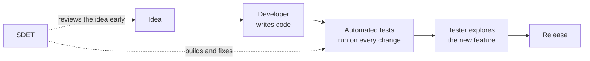

# The SDET Role: What an SDET Does and How to Grow into One

This topic explains what an SDET does, the skills the job needs, and the ideas every tester works by. It ends with a self-assessment that shows you what to learn next.

!!! info "In plain words"
    Think of a building inspector. A manual tester walks through the house and checks each room by hand.
    An SDET does that too, but also builds machines that check every room, every night, without being asked.
    **SDET** means Software Development Engineer in Test: a tester who writes code to test software.

!!! example "Your task"
    Arshad has tested the shop by hand for two years. His lead says: "We want you as our team's first SDET. Can you plan your first 90 days?"
    This page follows Arshad through that plan with the [Practice App](../../start-here/practice-app-tour/index.md). It is an example, but the steps are the ones real testers use when they grow into the role.

## Jump to what you need

- [What an SDET does](what-an-sdet-does.md): the daily work, with a real test run
- [SDET vs QA vs developer](sdet-vs-qa-vs-developer.md): who does what with the same bug
- [Skills map](skills-map.md): the skills, and how to score yours
- [The seven testing principles](seven-testing-principles.md): the ideas every tester works by
- [The test process and testware](test-process-and-testware.md): the seven activities of testing, and what each one produces

## 1. Understand the ask

"Be our SDET" can mean many things. Arshad uses the [day-one questions](../learning-a-new-testing-area/index.md#templates) from the last topic and asks his lead:

| Arshad asks | His lead answers |
| --- | --- |
| What should I do more of? | Automate the checks we repeat before every release |
| What should I do less of? | Testing the same pages by hand every sprint |
| What does "done" mean after 90 days? | Smoke tests run on every change, and the team trusts them |
| Will I still test by hand? | Yes, for new features and for exploring |
| Who helps me with code? | Maria, a developer on the team, will review your code |

The answers show the job is not "stop testing, start coding". It is testing, plus code that saves time.

## 2. Picture the system

Draw where an SDET fits in the team. Arshad draws how a change travels from an idea to users:



The SDET does not wait at the end. They join at the start (reviewing the idea) and they own the machine in the middle (the automated tests).

## 3. Learn just enough

Arshad doesn't try to learn every tool at once. He reads three things this week:

1. [What an SDET does](what-an-sdet-does.md) on this site (15 minutes).
2. [The seven testing principles](seven-testing-principles.md): the ideas his team will expect him to know (20 minutes).
3. The Practice App's own tests in `practice-app/tests`, to see what real test code looks like (20 minutes).

## 4. Get something running

Before planning 90 days, Arshad runs the tests that already exist. From the repository folder:

```bash
.venv/bin/pytest practice-app/tests -q
```

You should see:

```text
177 passed, 1 skipped in 4.94s
```

Your time will be a little different. In five seconds, the computer did 177 checks that would take a person days. This is what an SDET builds and looks after.

## 5. Decide what to learn first

Arshad scores himself with the [skills self-assessment](#templates). He rates each skill from 0 (never done it) to 3 (can teach it), then runs the scoring script:

```bash
python score_skills.py arshad_skills.csv
```

You should see:

```text
Your SDET skills

Testing basics   ########    78%
Python           ##          22%
API testing      ##          17%
UI automation                 0%
Databases        #####       50%
Tools            #           11%
Teamwork         #####       50%

Overall: 33%

Learn next:
- Use pytest to write and run tests (Python, now: never done it)
- Test login tokens and permissions (API testing, now: never done it)
- Find elements with stable locators (UI automation, now: never done it)
```

His testing basics are strong. His gaps are code and tools. That is normal for a manual tester, and it tells him exactly where to start. [Skills map](skills-map.md) explains each area.

## 6. Write a one-page plan

Arshad turns the scores into a short 90-day plan and shares it with his lead:

| When | Goal | Proof it is done |
| --- | --- | --- |
| Days 1 to 30 | Python basics and pytest | 10 small pytest tests for the shop's prices |
| Days 31 to 60 | API testing | Smoke tests for login, cart and checkout |
| Days 61 to 90 | Run tests on every change | Tests run in the team's pipeline, and the team looks at the results |

Every goal has proof you can show. "Learn Python" can't be checked. "10 tests that pass" can.

## 7. Build in small steps

Arshad keeps testing by hand while he learns. Each week he automates one check he used to do by hand, starting with the most boring and most repeated one. The [Python for testers](../../start-here/python-for-testers/index.md) and [pytest](../../core-automation/pytest-framework/index.md) topics teach the code.

## 8. Report and get feedback

Every two weeks, Arshad shows his lead three things: the new tests, a bug they caught, and what he will learn next. After a month he scores himself again and compares the two reports. A number that went from 0% to 50% is easier to show than "I learned a lot".

## 9. Keep learning on your own

Score yourself again every three months. Your "Learn next" list changes as you grow. Next, read [Test levels and the pyramid](../test-levels-and-the-pyramid/index.md) to decide which tests to automate first.

!!! tip "How an experienced SDET thinks about this"
    - Code is a tool for testing, not the goal. A test that nobody runs or trusts is worth nothing.
    - Keep your tester's eye. The best SDETs still explore by hand, because automation only checks what someone thought of.
    - Automate what is boring, repeated and stable first. A page that changes every week is a poor first target.
    - Ask developers to review your test code. It is the fastest way to learn, and it makes them trust the tests.

!!! warning "Red flags"
    - You stopped testing by hand completely as soon as you started coding.
    - You count tests instead of bugs caught. 500 tests that never fail may test nothing useful.
    - Your plan says "learn Python" with no proof of being done.
    - You try to learn five tools at once and finish none.
    - Only you can run or fix the tests. If you are on holiday, nobody can use them.

## Templates

Copy these into your own folder. Each code file starts with a comment line that says where it came from. A CSV file can't have comments, so the credit is in the scoring script.

=== "Skills self-assessment (CSV)"

    ```text
    --8<-- "modules/think_like_a_tester/the_sdet_role/templates/skills_self_assessment.csv"
    ```

=== "Scoring script"

    ```python
    --8<-- "modules/think_like_a_tester/the_sdet_role/templates/score_skills.py"
    ```

=== "Example: Arshad's scores"

    ```text
    --8<-- "modules/think_like_a_tester/the_sdet_role/examples/arshad_skills.csv"
    ```

=== "How to use it"

    1. Copy both template files into one folder.
    2. Open the CSV in a spreadsheet program or a text editor. Change each `0` to your level: 0 never done it, 1 with help, 2 alone, 3 can teach it.
    3. Save it as CSV, then run `python score_skills.py skills_self_assessment.csv`.
    4. Learn the three skills under "Learn next". Score yourself again in three months.
    5. Add your own rows if your team uses other skills. Keep the three column names as they are.

## Bug Hunt

A good SDET compares two views of the same data. In the Practice App, add the same book to your cart three times, then look at the cart badge in the top bar, and at the cart page.

Hint: the two numbers should agree. Do they? Check the API answer at `/api/cart` too: which one is right?

When you have found it, check your answer in the [Practice App tour](../../start-here/practice-app-tour/index.md#bug-hunts), Bug Hunt **BH-05** (folded, so you can't see it by accident).

## Official resources

- [ISTQB Certified Tester Foundation Level](https://istqb.org/certifications/certified-tester-foundation-level-ctfl-v4-0/): the seven principles and the test process come from this syllabus
- [ISTQB Glossary](https://glossary.istqb.org/): the official meaning of testing words
- [pytest documentation](https://docs.pytest.org/en/stable/): the test tool used across this site
