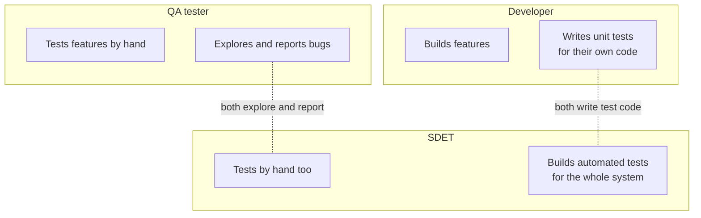

# SDET vs QA vs Developer: Who Does What with the Same Bug

This lesson compares the three roles by following one bug through a team, so you can see where each job starts and stops.

!!! note "Before you start"
    Read [What an SDET does](what-an-sdet-does.md) first.
    **QA** means Quality Assurance. In job ads it usually means a tester who mostly tests by hand.

## What you will learn

- What a developer, a QA tester and an SDET each do
- Where the three jobs overlap
- How the same bug looks to each of them
- How to tell from a job ad which role it really is

## Why this matters at work

Job titles are messy. One company's "QA Engineer" writes code all day; another's "SDET" mostly tests by hand. If you know what the work is, you can ask the right questions in an interview, and you know which skills to grow.

## The idea in plain words

!!! info "In plain words"
    Think of a restaurant. The cook makes the food and tastes it. The food inspector checks plates by looking, smelling and tasting.
    An SDET is like an inspector who also builds a machine that checks every plate for the right temperature, all night.
    All three care about good food. They just check it in different ways.



## Step by step

We follow one bug from the Practice App: an order of exactly $50.00 is charged $4.99 shipping, but the shop promises free shipping from $50.

1. **The QA tester finds it by hand.** They build a cart of exactly $50.00 and look at the total. Shipping says $4.99. They write a bug report with the steps, what they expected and what they saw.

2. **The developer fixes it, and adds a unit test.** A **unit test** checks one small piece of code on its own, like the function that works out shipping. The developer's test checks 49.99, 50.00 and 50.01. It runs in milliseconds:

    ```bash
    .venv/bin/pytest practice-app/tests/test_money.py -q
    ```

    You should see:

    ```text
    11 passed in 0.02s
    ```

3. **The SDET checks the whole shop, through the API.** The unit test proves the function is right. It does not prove the cart, the coupon and the checkout use it the right way. The SDET's tests send real requests to the shop, like a user would. Here is one that checks the cart's limits:

    ```python
    def test_quantity_is_1_to_10(client, login):
        headers = login()
        assert add(client, headers, PYTHON_BOOK, 0).status_code == 422
        assert add(client, headers, PYTHON_BOOK, 11).status_code == 422
        add(client, headers, PYTHON_BOOK, 10)
        assert error_code(add(client, headers, PYTHON_BOOK, 1)) == "QUANTITY_LIMIT"
    ```

    Run the whole cart and order file:

    ```bash
    .venv/bin/pytest practice-app/tests/test_cart_and_orders.py -q
    ```

    You should see:

    ```text
    23 passed in 0.79s
    ```

4. **Compare the three jobs side by side.**

    | | Developer | QA tester | SDET |
    | --- | --- | --- | --- |
    | Main goal | Build the feature | Find what is wrong | Find what is wrong, and stop it coming back |
    | Tests by hand | A little | Most of the time | Often, for new features |
    | Writes test code | Unit tests for their code | Sometimes, or never | Every week, for the whole system |
    | Typical tests | Unit tests | Manual test cases, exploring | API, UI and end-to-end tests |
    | Asks most often | "Does my code work?" | "What can go wrong for the user?" | "How do we know it keeps working?" |

5. **Read a job ad the right way.** Ignore the title. Look at the tasks. "Write and maintain automated tests in Python" means SDET work, whatever the title says. "Execute test cases and log defects" means mostly manual QA work.

    !!! success "Check: you should now be able to"
        Say what each role does with the same bug, and spot from the tasks in a job ad which role it is.

## Common mistakes

!!! warning "Common mistakes"
    - **Thinking one role is "better".** Teams need all three kinds of thinking. A great manual tester finds bugs nobody thought to automate.
    - **Thinking developers don't test.** Good developers write many tests. The SDET adds tests that cross many parts of the system.
    - **Trusting the job title.** Read the list of tasks. Titles mean different things at different companies.

!!! failure "If you see this error"
    **`ERROR: file or directory not found: practice-app/tests/test_money.py`**
    You ran pytest from the wrong folder. Go to the repository folder, the one that has `practice-app` inside it, and run the command again.

## Try it yourself

Read this job ad task list. Is it mostly developer, QA or SDET work?

```text
- Explore new features and report bugs with clear steps
- Build and maintain API tests in Python with pytest
- Add the tests to the CI pipeline and keep them stable
- Review user stories with the product owner before sprint start
```

??? success "Solution"
    SDET. It has manual work (explore, report, review stories) and test code for the whole system (API tests, CI, keeping them stable). A QA job would not ask for Python test code. A developer job would talk about building features.

## Quick check

1. What is a unit test?

    ??? question "Answer"
        A test that checks one small piece of code on its own, like one function.

2. The developer's unit test passed. Why does the SDET still test checkout through the API?

    ??? question "Answer"
        A correct function can still be used the wrong way. API tests check that the parts work together, the way a user uses them.

3. A job is called "QA Engineer" but the tasks say "build Playwright tests in Python". Which role is it really?

    ??? question "Answer"
        SDET work. The tasks matter more than the title.

## References

- [ISTQB Glossary](https://glossary.istqb.org/): unit testing (component testing), test automation
- [pytest: How to invoke pytest](https://docs.pytest.org/en/stable/how-to/usage.html)

Written for Bookshelf 1.0.0 and pytest 9. Links checked: November 2026.
