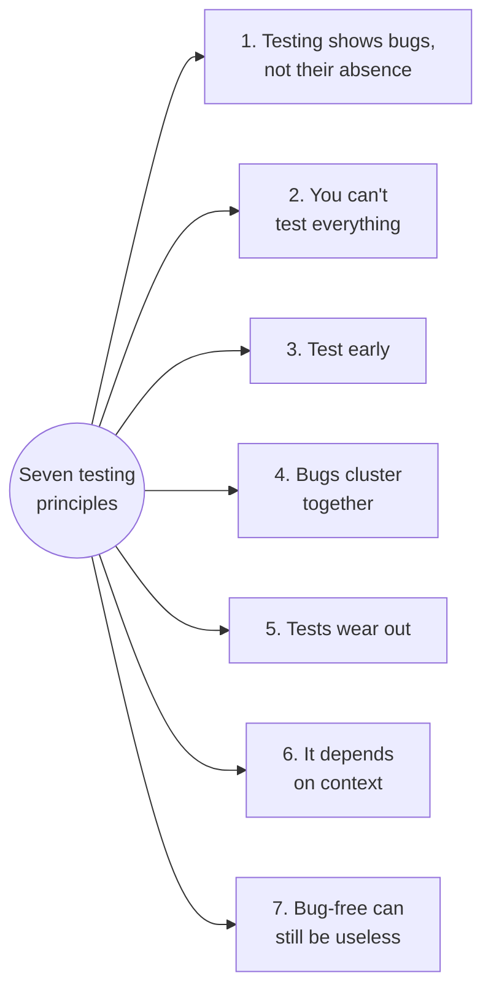

# The Seven Testing Principles, with Real Examples

This lesson explains the seven testing principles. Testers everywhere use them, and job interviews often ask about them. You will see three of them happen in the Practice App.

!!! note "Before you start"
    Read [What an SDET does](what-an-sdet-does.md) first.
    The principles come from the ISTQB Foundation Level syllabus, version 4.0. **ISTQB** is a group that writes testing exams used in many countries.

## What you will learn

- The seven principles, in plain words
- Why 177 passing tests did not mean "no bugs"
- How the principles change what you test first
- How to answer "name the testing principles" in an interview

## Why this matters at work

Sooner or later, someone asks: "The tests pass, so it has no bugs, right?" Or: "Why didn't you test everything?" The principles give you clear, honest answers. They also help you spend your time on the tests that matter most.

## The idea in plain words

!!! info "In plain words"
    A doctor's check-up can find that you are ill. It can never prove you will never get ill.
    Testing is the same. It finds problems, but it can't prove there are none. The seven principles are seven ideas like this one.



## Step by step

1. **Testing shows that bugs are there, not that they are gone.** The Practice App has six bugs planted on purpose. Run its login tests with those bugs switched on:

    ```bash
    BOOKSHELF_TEST_BUGS=on .venv/bin/pytest practice-app/tests/test_auth.py -q
    ```

    You should see:

    ```text
    26 passed in 0.44s
    ```

    Every test passed. But one planted bug lives in password reset: an old reset code still works after its 10 minutes. No test checks that case, so nothing failed. "All tests pass" only means "the things we checked work".

2. **You can't test everything.** A quantity field that takes 1 to 10, a coupon box and a card number already make millions of combinations. So you choose. Run the whole suite with the bugs on:

    ```bash
    BOOKSHELF_TEST_BUGS=on .venv/bin/pytest practice-app/tests -q
    ```

    You should see:

    ```text
    FAILED practice-app/tests/test_catalog.py::test_pages - AssertionError: asser...
    FAILED practice-app/tests/test_files_and_email.py::test_no_invoice_for_someone_elses_order
    FAILED practice-app/tests/test_money.py::test_free_shipping_from_50[5000-0]
    3 failed, 174 passed, 1 skipped in 5.31s
    ```

    pytest cuts long lines to fit your terminal, so yours may be a little longer or shorter.

    177 tests caught only 3 of the 6 bugs. More tests would not fix this by themselves. Better chosen tests would. That is why [test design techniques](../test-design-techniques/index.md) exist.

3. **Test early.** A bug found while reading the story costs one question. The same bug found after release costs a fix, a new release and unhappy customers. Ask "is exactly $50.00 free?" before the code exists, and the shipping bug never gets written.

4. **Bugs cluster together.** Most bugs hide in a few parts of a system, often the complex or most-changed parts. If you find one bug in checkout, look harder at checkout, not less.

5. **Tests wear out.** Running the same tests again and again finds fewer new bugs over time. Old tests still protect what already works, but to find new bugs you need new tests and new data. ISTQB calls this the **pesticide paradox**: insects get used to the same spray.

6. **Testing depends on context.** A bank app and a hobby blog need very different testing. For the Practice App, money and logins get the most tests, because mistakes there hurt users most.

7. **Bug-free can still be useless.** A shop with no bugs but no search box fails its users. Testing also asks: "Is this what people need?" This is the **absence-of-errors fallacy** (a fallacy is a wrong belief).

    !!! success "Check: you should now be able to"
        Name the seven principles, and explain why "26 passed" did not prove the login code was bug-free.

## Common mistakes

!!! warning "Common mistakes"
    - **Saying "tested, so no bugs".** Say what you tested and what you didn't. That is honest and useful.
    - **Using "you can't test everything" as an excuse.** It means "choose wisely", not "test less". Test the riskiest parts first.
    - **Never changing old tests.** Add new cases when you find bugs, or the suite stops finding anything new.

!!! failure "If you see this error"
    **`FAILED practice-app/tests/test_money.py::test_free_shipping_from_50[5000-0]`**
    You ran the tests with `BOOKSHELF_TEST_BUGS=on`, so this failure is expected: it is a planted bug being caught. Run without that setting to see the correct shop pass.

## Try it yourself

Your lead says: "The checkout tests all passed last night, so we can release." Write a short, polite answer that uses at least two principles.

??? success "Solution"
    One possible answer:

    ```text
    The checkout tests passed, which is good news: what we checked works.
    It doesn't prove checkout has no bugs (principle 1). For example, we don't test
    coupon + free shipping together yet. Bugs often cluster in checkout (principle 4),
    so I'd like 30 minutes to explore it by hand before we release.
    ```

## Quick check

1. All 26 login tests passed with a bug in password reset. Which principle does that show?

    ??? question "Answer"
        Principle 1: testing shows that bugs are there, not that they are gone.

2. What is the pesticide paradox?

    ??? question "Answer"
        Running the same tests again and again finds fewer new bugs. You need new tests and new data to find new bugs.

3. You found two bugs in the coupon code. Where should you look next?

    ??? question "Answer"
        At the coupon code and the parts near it. Bugs cluster together.

## References

- [ISTQB Certified Tester Foundation Level v4.0](https://istqb.org/certifications/certified-tester-foundation-level-ctfl-v4-0/): section 1.3, the seven testing principles
- [ISTQB Glossary](https://glossary.istqb.org/): pesticide paradox, defect clustering, exhaustive testing

Written for Bookshelf 1.0.0 and the ISTQB CTFL v4.0 syllabus. Links checked: November 2026.
