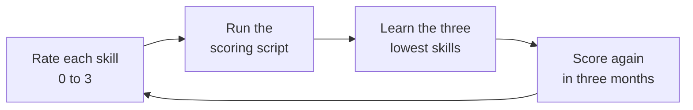

# SDET Skills Map: Score Yourself and Find What to Learn Next

This lesson shows the seven areas of SDET skills, and how to score yourself so you know what to learn next.

!!! note "Before you start"
    Read [What an SDET does](what-an-sdet-does.md) first.
    You need Python 3 to run the scoring script. If you don't have it yet, you can still fill in the CSV file and add up your scores by hand.

## What you will learn

- The seven skill areas, and why each one matters
- How to rate a skill honestly, from 0 to 3
- How to run the scoring script and read its report
- How to turn the report into a learning plan

## Why this matters at work

"I want to be an SDET" is too big to act on. A list of skills, each with a score, turns it into small steps. It also helps at work: your lead can see what you are learning, and you can show progress with numbers.

## The idea in plain words

!!! info "In plain words"
    Before a long trip, you check your car: tyres, oil, lights, fuel. You don't fix everything. You fix what is lowest first.
    The skills map works the same way. You check each skill, then work on the three that need it most.



## Step by step

1. **Meet the seven areas.**

    | Area | What it means | Where this site teaches it |
    | --- | --- | --- |
    | Testing basics | Test cases, test design, bug reports | [Think like a tester](../index.md) |
    | Python | Write and read code, use pytest | [Python for testers](../../start-here/python-for-testers/index.md) |
    | API testing | Send requests, check answers, logins | [API testing](../../core-automation/api-testing/index.md) |
    | UI automation | Find elements, write Playwright tests | [UI automation](../../core-automation/ui-automation/index.md) |
    | Databases | Write SQL, check saved data | [Database testing](../../core-automation/database-testing/index.md) |
    | Tools | Git, CI pipelines, Docker | [Toolbox](../../toolbox/index.md) |
    | Teamwork | Questions, plans, explaining risk | [Professional SDET](../../professional-sdet/index.md) |

    The full list, from junior to lead, is on the [Skills Matrix](../../start-here/skills-matrix.md). This lesson uses a short version for your first score.

2. **Copy the two template files** from the [templates on the topic page](index.md#templates): `skills_self_assessment.csv` and `score_skills.py`. Put them in one folder.

3. **Rate each skill honestly.** Open the CSV and change each `0` to your level:

    | Level | Means | Example for "Write a Playwright test" |
    | --- | --- | --- |
    | 0 | Never done it | You have heard of Playwright, nothing more |
    | 1 | Done it with help | You followed a tutorial step by step |
    | 2 | Can do it alone | You wrote a test for a new page without help |
    | 3 | Can teach it | You could show a teammate and answer their questions |

    Rate what you have done, not what you have read about. Reading about swimming does not make it a 2.

4. **Run the script.** Arshad's scores are in `arshad_skills.csv`:

    ```bash
    python score_skills.py arshad_skills.csv
    ```

    You should see:

    ```text
    Your SDET skills

    Testing basics   ########    78%
    Python           ##          22%
    API testing      ##          17%
    UI automation                 0%
    Databases        #####       50%
    Tools            #           11%
    Teamwork         #####       50%

    Overall: 33%

    Learn next:
    - Use pytest to write and run tests (Python, now: never done it)
    - Test login tokens and permissions (API testing, now: never done it)
    - Find elements with stable locators (UI automation, now: never done it)
    ```

5. **Read the report.** Each bar is one area. 100% means you could teach every skill in it. "Learn next" lists the three lowest skills. When many skills share the lowest level, it picks the ones nearest the top of the file, so put the skills that matter most for your team first.

6. **Turn it into a plan.** Arshad picks one "Learn next" skill per month, each with proof he can show: "pytest" becomes "10 passing tests for shop prices".

    !!! success "Check: you should now have"
        Your own CSV with honest levels, a report from the script, and three skills to learn next.

## The template

=== "Skills self-assessment (CSV)"

    ```text
    --8<-- "modules/think_like_a_tester/the_sdet_role/templates/skills_self_assessment.csv"
    ```

=== "Scoring script"

    ```python
    --8<-- "modules/think_like_a_tester/the_sdet_role/templates/score_skills.py"
    ```

=== "How to use it"

    1. Keep the first line (`area,skill,level`) exactly as it is.
    2. Add or remove rows to match your team. Each row needs an area, a skill and a level from 0 to 3.
    3. If a skill has a comma in it, put the skill in double quotes, like `"Read, write and review SQL"`.
    4. Keep each score file with a date in its name, like `skills_2026-11.csv`, so you can compare later.

## Common mistakes

!!! warning "Common mistakes"
    - **Rating what you read, not what you did.** Your score should match what you can do without help today.
    - **Trying to fix every gap at once.** Three skills at a time is enough. The script shows three on purpose.
    - **Never scoring again.** The second score is the useful one: it shows you are growing.

!!! failure "If you see this error"
    **`Could not read the file: Line 5: level must be 0, 1, 2 or 3, not 4`**
    One row has a level the script does not know. Open the CSV, go to the line it names, and use 0, 1, 2 or 3.

    **`Could not read the file: [Errno 2] No such file or directory: 'nope.csv'`**
    The file name is wrong, or the file is in another folder. Check the name, and run the command from the folder that holds the CSV.

## Try it yourself

Maria rated herself 3 in every Testing basics skill and 0 in all the rest. Without running the script, what does it say she should learn next?

??? success "Solution"
    The three lowest skills nearest the top of the file. All of them are 0, so it picks the first three after Testing basics:

    ```text
    Learn next:
    - Write functions and loops (Python, now: never done it)
    - Read other people's code (Python, now: never done it)
    - Use pytest to write and run tests (Python, now: never done it)
    ```

    You can check it: make a copy of the template, change the first three levels to 3, and run the script.

## Quick check

1. What does level 2 mean?

    ??? question "Answer"
        You can do the skill alone, without help.

2. Why does the script suggest only three skills?

    ??? question "Answer"
        Learning a few things at a time works better than starting many and finishing none.

3. When many skills have the same low level, which ones does the script pick?

    ??? question "Answer"
        The ones nearest the top of the file. Put the skills that matter most for your team first.

## References

- [Python: the csv module](https://docs.python.org/3/library/csv.html): how the script reads the file
- [Skills Matrix](../../start-here/skills-matrix.md): every SDET skill from junior to lead

Written for Python 3.13. Links checked: November 2026.
