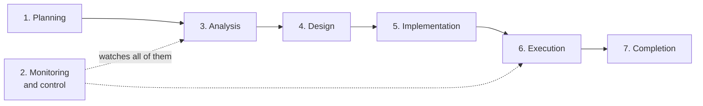

# The Test Process and Testware: Seven Activities, Explained Simply

This lesson explains the seven activities that make up testing, and the things each one produces. Those things are called **testware**.

!!! note "Before you start"
    Read [The seven testing principles](seven-testing-principles.md) first.
    It helps to know the [9-step playbook](../learning-a-new-testing-area/the-9-step-playbook.md): it is the same process, in everyday words.

## What you will learn

- The seven test activities, in order
- What testware is, with an example for each activity
- How the activities match the 9-step playbook
- Why the activities overlap and repeat

## Why this matters at work

Interviews often ask: "Walk me through how you test a feature." Teams also use these words in plans and reports: "We are in test analysis", "Exit criteria are met". Knowing the activities lets you answer clearly and follow those talks.

## The idea in plain words

!!! info "In plain words"
    Building a house has stages: plan it, design it, gather the materials, build it, check it, hand over the keys.
    Each stage leaves something behind: a drawing, a list, a finished wall. Testing has stages too, and what each stage leaves behind is testware.



## Step by step

We use Arshad's task from the last topic: test password reset in the shop.

1. **Test planning: decide the goal and the approach.** What to test, what not to test, how, and when it is done.
    *Testware:* a test plan. Arshad's is the [one-page test plan](../learning-a-new-testing-area/index.md#templates).

2. **Test monitoring and control: check progress, and change course.** This runs the whole time. If tests find many bugs in one place, you move time there.
    *Testware:* progress notes, short status reports.

3. **Test analysis: decide what to test.** Read the story and find the things worth testing. ISTQB calls these **test conditions**. Example: "a code older than 10 minutes must not work."
    *Testware:* a list of test conditions, sorted by risk.

4. **Test design: decide how to test each condition.** Turn conditions into test cases with inputs and expected results. Example: "ask for a code, move the clock 11 minutes, use the code; expect `CODE_EXPIRED`."
    *Testware:* test cases and the test data they need.

5. **Test implementation: get everything ready to run.** Write the automated tests, prepare the data, set up the test environment.
    *Testware:* test scripts, test data files, a running Practice App.

6. **Test execution: run the tests and compare the results.** Run the tests, and check every result against what you expected. Arshad runs the reset tests:

    ```bash
    .venv/bin/pytest practice-app/tests/test_auth.py -k reset -v
    ```

    You should see:

    ```text
    practice-app/tests/test_auth.py::test_a_good_login_resets_the_wrong_password_count PASSED [ 50%]
    practice-app/tests/test_auth.py::test_reset_password_with_the_code PASSED [100%]
    ```

    Read results with care. `-k reset` picks every test with "reset" in its name, so it also ran a login test that has nothing to do with password reset. Only one test really checks the reset flow, and no test checks an old code. That gap goes into the report.
    *Testware:* test results, logs and bug reports.

7. **Test completion: wrap up and learn.** Check the exit criteria, report what was and wasn't tested, save what can be reused, and note what to do better next time.
    *Testware:* a test completion report, and testware stored for the next release.

8. **See how it matches the playbook.** The activities are the same work you did in the [9-step playbook](../learning-a-new-testing-area/the-9-step-playbook.md), with formal names:

    | Test activity | Playbook step |
    | --- | --- |
    | Planning | 1. Understand the ask, 6. Write a one-page plan |
    | Monitoring and control | 8. Report and get feedback (and all along the way) |
    | Analysis | 2. Picture the system, 5. Decide what to test |
    | Design | 5. Decide what to test |
    | Implementation | 4. Get something running, 7. Build in small steps |
    | Execution | 7. Build in small steps |
    | Completion | 8. Report, 9. Keep learning |

    !!! success "Check: you should now be able to"
        Name the seven activities in order, and give one piece of testware for each.

## Common mistakes

!!! warning "Common mistakes"
    - **Thinking the activities happen once, in a strict line.** They overlap and repeat. In a two-week sprint you may do all seven in a few days.
    - **Thinking testware means only test code.** Plans, test cases, data, results and reports are all testware.
    - **Skipping completion.** Without a short report, the next person can't see what was tested or reuse your work.

!!! failure "If you see this error"
    **`2 passed, 24 deselected in 0.09s`, but you expected more tests**
    `-k` matched fewer tests than you thought. Run with `-v` to see the names it picked, then change the word after `-k`. It searches test names, not what the tests do.

## Try it yourself

For the task "test product reviews", write one piece of testware for analysis, design and execution.

??? success "Solution"
    One possible answer:

    | Activity | Testware |
    | --- | --- |
    | Analysis | Test condition: "only people who bought the book can review it" |
    | Design | Test case: log in as a user with no orders, post a review, expect an error |
    | Execution | Result: "error as expected", or a bug report if the review was saved |

## Quick check

1. What is testware?

    ??? question "Answer"
        Everything testing produces: plans, test conditions, test cases, test data, scripts, results and reports.

2. Which activity runs the whole time, alongside the others?

    ??? question "Answer"
        Test monitoring and control.

3. What is the difference between test analysis and test design?

    ??? question "Answer"
        Analysis decides what to test (test conditions). Design decides how to test it (test cases with inputs and expected results).

## References

- [ISTQB Certified Tester Foundation Level v4.0](https://istqb.org/certifications/certified-tester-foundation-level-ctfl-v4-0/): section 1.4, test activities, testware and roles
- [ISTQB Glossary](https://glossary.istqb.org/): testware, test condition, exit criteria
- [pytest: Specifying which tests to run](https://docs.pytest.org/en/stable/how-to/usage.html#specifying-which-tests-to-run)

Written for Bookshelf 1.0.0, pytest 9 and the ISTQB CTFL v4.0 syllabus. Links checked: November 2026.
