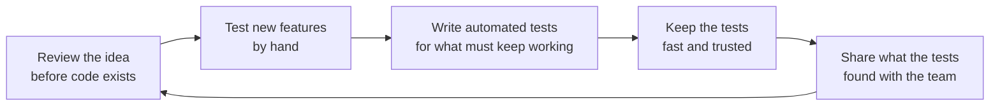

# What Does an SDET Do? The Daily Work, Explained Simply

This lesson explains what an SDET does in a normal week, and shows you an automated test catching a real bug.

!!! note "Before you start"
    You don't need any testing or coding experience.
    It helps to have the [Practice App](../../start-here/practice-app-tour/index.md) set up, so you can run the test yourself.

## What you will learn

- What the letters SDET mean
- The five kinds of work an SDET does in a week
- What an automated test is, and what it looks like when it catches a bug
- What an SDET does not do

## Why this matters at work

Job ads use the words SDET, QA engineer, test automation engineer and quality engineer for jobs that overlap a lot. If you know what the work really is, you can read any job ad, see what it asks for, and explain your own work in an interview.

## The idea in plain words

!!! info "In plain words"
    A smoke alarm checks for fire all day and night, so nobody has to sniff the air every hour.
    An SDET builds smoke alarms for software: small programs that check the app again and again, and shout when something breaks.
    But someone still has to decide where to put the alarms. That part is the tester's thinking.



## Step by step

1. **Know what the letters mean.** SDET stands for **Software Development Engineer in Test**. It is an engineer whose main job is testing, and who writes code to do it.

2. **Learn the five kinds of work.** A normal week has a bit of each:

    | Work | Example in the shop |
    | --- | --- |
    | Review ideas early | "The story says free shipping from $50. Is exactly $50.00 free?" |
    | Test by hand | Try the new coupon box with odd inputs before anyone automates it |
    | Write automated tests | A test that checks shipping at $49.99, $50.00 and $50.01 |
    | Keep tests healthy | Fix a test that fails at random, so the team trusts the results |
    | Share results | Tell the team which bug the tests caught, and what is still not tested |

3. **See an automated test.** An automated test is code that uses the app and checks the answer. This test from the Practice App checks free shipping at four amounts (in cents, so 5000 means $50.00):

    ```python
    @pytest.mark.parametrize(("subtotal", "shipping"), [
        (0, 0),        # empty cart: no shipping
        (4999, 499),   # 49.99: just under the free shipping line
        (5000, 0),     # 50.00: free
        (5001, 0),
    ])
    def test_free_shipping_from_50(subtotal, shipping):
        assert calculate(subtotal).shipping_cents == shipping
    ```

    `assert` is the check. If the shipping is not what the line says, the test fails.

4. **Run it.** From the repository folder:

    ```bash
    .venv/bin/pytest practice-app/tests/test_money.py -q
    ```

    You should see:

    ```text
    11 passed in 0.02s
    ```

    All 11 money tests passed: the four shipping checks and seven others.

5. **Watch it catch a bug.** The Practice App has bugs planted on purpose. Run the same tests with them switched on:

    ```bash
    BOOKSHELF_TEST_BUGS=on .venv/bin/pytest practice-app/tests/test_money.py -q
    ```

    You should see:

    ```text
    FAILED practice-app/tests/test_money.py::test_free_shipping_from_50[5000-0]
    1 failed, 10 passed in 0.05s
    ```

    The name tells you exactly what broke: free shipping at a subtotal of 5000 cents ($50.00). A person checking by hand would need to build a $50.00 cart to see this. The test checks it in a fraction of a second, every time anyone changes the code.

6. **Know what an SDET does not do.** An SDET is not the only person who cares about quality, and not a "bug catcher" at the end. Developers still test their own code. The whole team owns quality; the SDET makes testing faster and easier for everyone.

    !!! success "Check: you should now be able to"
        Say what SDET stands for, name the five kinds of work, and explain what the failed test name means.

## Common mistakes

!!! warning "Common mistakes"
    - **Thinking SDET means "only automation".** The tester's thinking decides what to automate. Without it, you automate the wrong things fast.
    - **Thinking you must be a strong developer first.** Many SDETs start as manual testers and learn code one test at a time.
    - **Measuring yourself by the number of tests.** A few tests that catch real bugs beat hundreds that never fail.

!!! failure "If you see this error"
    **`zsh: no such file or directory: .venv/bin/pytest`**
    You are not in the repository folder, or the setup has not been done yet. Go to the folder that has `practice-app` in it, and follow [Environment setup](../../start-here/environment-setup/index.md).

## Try it yourself

Look at the shipping test above. Which line would you add to also check a subtotal of $0.01 (1 cent)? What shipping do you expect?

??? success "Solution"
    Add this line inside the list:

    ```python
    (1, 499),      # 0.01: a tiny order still pays shipping
    ```

    Any order under $50.00 pays $4.99 shipping, so 1 cent should give 499. An empty cart (0) pays nothing, because there is nothing to ship.

## Quick check

1. What does SDET stand for?

    ??? question "Answer"
        Software Development Engineer in Test.

2. Why is an automated test useful if a person could check the same thing by hand?

    ??? question "Answer"
        It runs in a fraction of a second, every time the code changes, and it never forgets or gets bored.

3. Does an SDET stop testing by hand?

    ??? question "Answer"
        No. New features are explored by hand first. Automation checks the things that must keep working.

## References

- [ISTQB Glossary](https://glossary.istqb.org/): test automation, test case and other terms
- [pytest: Get started](https://docs.pytest.org/en/stable/getting-started.html)
- [pytest: Parametrizing tests](https://docs.pytest.org/en/stable/how-to/parametrize.html)

Written for Bookshelf 1.0.0 and pytest 9. Links checked: November 2026.
